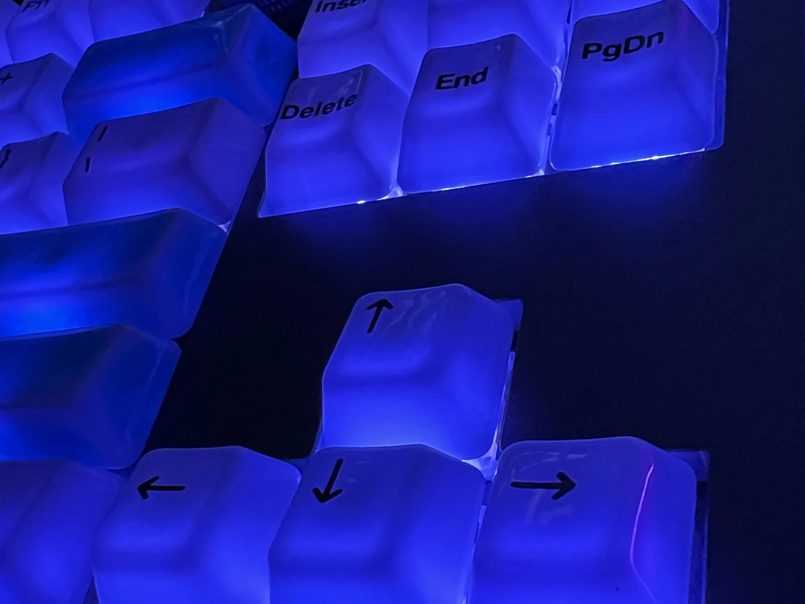

## Hi, I'm Aaron 👋

Security researcher, developer, and hardware enthusiast. Most of my time currently goes into **PS3 reverse engineering and static recompilation**, and into **C#/.NET tooling for AI assistants** built on the Model Context Protocol.

### 🔭 Currently working on

- **Warhawk.** Turning *Warhawk* (2007, Incognito Entertainment / SCE) from a PS3 disc binary into native executables using static recompilation, powered by [ps3recomp](https://github.com/sp00nznet/ps3recomp) and other AI-developed tools. *(Project source will remain private for the time being.)*
- **Starhawk, next.** Applying the lessons from Warhawk to *Starhawk* (2012, LightBox Interactive / SCE). *(Project source will remain private for the time being.)*
- **Local-first AI tooling.** A Native AOT MCP server that hands private-file tasks to a locally hosted model (LM Studio / vLLM), so sensitive files never leave the machine. *(Project source will remain private for the time being.)*

### 🛠️ Tech I work with

